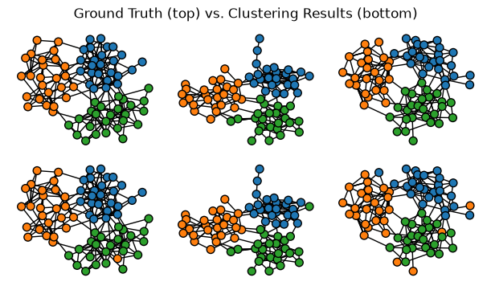
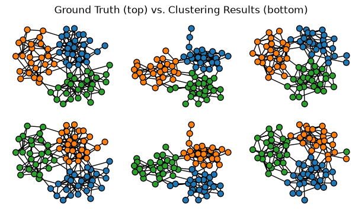
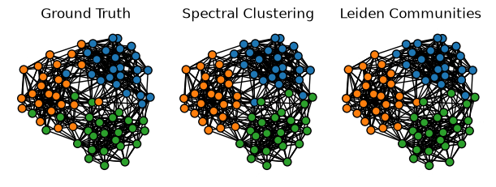
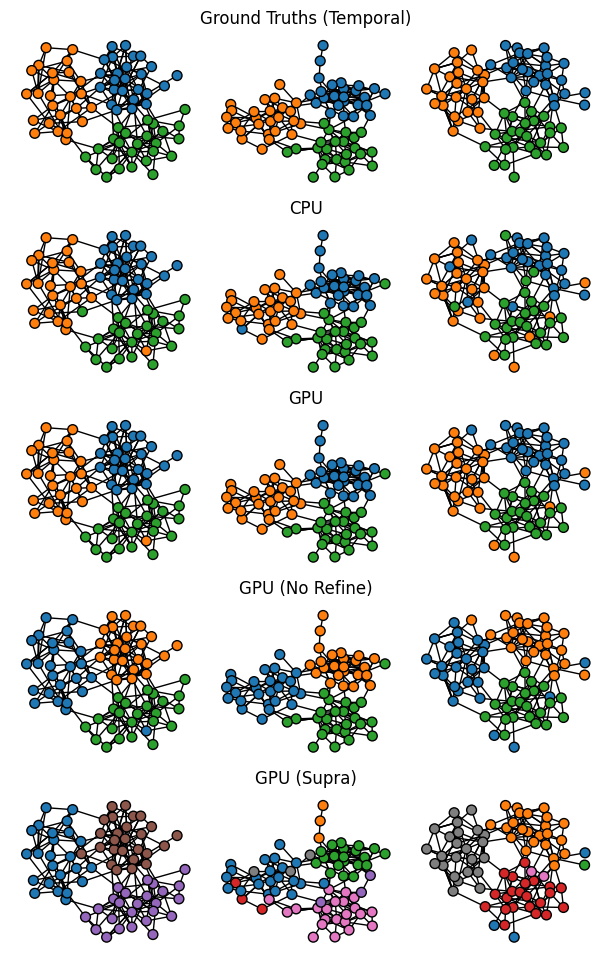
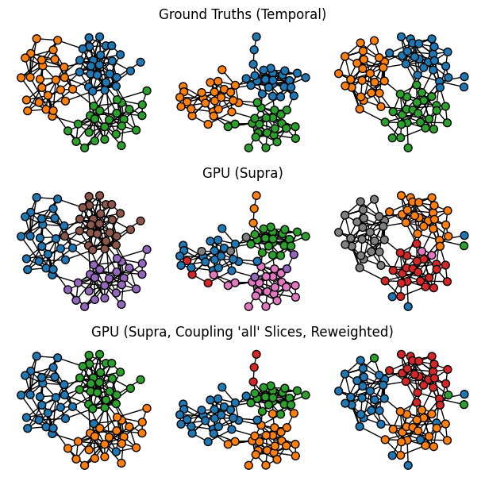

.. include:: ../include-template.rst

################
GPU acceleration
################

   .. image:: https://colab.research.google.com/assets/colab-badge.svg
      :target: https://colab.research.google.com/github/nelsonaloysio/networkx-temporal/blob/main/notebook/networkx-temporal-05-gpu.ipynb
      :alt: Open on Colab
      :align: right

   Examples in this guide are also available as an interactive
   `Jupyter notebook
   <https://github.com/nelsonaloysio/networkx-temporal/blob/main/notebook/networkx-temporal-05-gpu.ipynb>`__.

GPU acceleration allows to significantly speed up computations of algorithms for temporal graphs
on specialized hardware. This guide demonstrates how to enable GPU acceleration in NetworkX-Temporal
and provides some examples of its usage for community detection algorithms.

Accelerating temporal graph algorithms
======================================

Some algorithms for temporal networks can be computationally intensive,
especially for large-scale networks. To address this, NetworkX-Temporal
integrates GPU-accelerated implementations with the open-source libraries
CuPy, cuML, and cuGraph, substantially reducing their computation time.

- `CuPy <https://docs.cupy.dev/en/stable/install.html>`__:
  Array computations on GPUs, similar to NumPy and SciPy (required -- AMD/NVIDIA);
- `cuML <https://docs.rapids.ai/install/>`__:
  Machine learning algorithms part of the RAPIDS suite (optional -- NVIDIA only);
- `cuGraph <https://docs.nvidia.com/cugraph/latest/installation/getting_cugraph/>`__:
  Graph computations part of the same suite (optional -- NVIDIA only).

.. code-block:: bash

   # Required for all accelerated algorithms on NVIDIA GPUs (CUDA)...
   conda install -c conda-forge cupy

   # ...or on AMD GPUs (ROCm, experimental; separate build).
   # pip install amd-cupy --extra-index-url=https://pypi.amd.com/simple

   # (Optional) Required for accelerated k-means (NVIDIA only).
   conda install -c rapidsai -c nvidia -c conda-forge cuml

Once installed, GPU acceleration may be enabled by passing the parameter
``device='gpu'`` to the relevant functions, or by setting ``NX_GPU_AUTOCONFIG=1`` in the
environment, allowing zero-code configuration and automatic switch to GPU device when supported
by the function. To verify it:

.. code-block:: python

   >>> # Enables GPU acceleration by default for supported algorithms.
   >>> import os
   >>> os.environ["NX_GPU_AUTOCONFIG"] = "1"

.. code-block:: python

   >>> # Verify GPU acceleration is enabled by default.
   >>> import networkx_temporal as tx
   >>> tx.is_gpu_enabled

   True

Currently, only algorithms relevant for temporal community detection are implemented with
support for GPU acceleration: `spectral clustering <#spectral-graph-clustering>`_ [1]_ and the
`Leiden <#leiden-communities>`_ [2]_ algorithm. Details on both are provided next, using the
:func:`~networkx_temporal.algorithms.spectral_clustering` and
:func:`~networkx_temporal.algorithms.leiden_communities` high-level functions.

Community detection
===================

For a first example, we will use a synthetic temporal graph generated by
the :func:`~networkx_temporal.generators.example_sbm_graph`
function, based on a stochastic block model (SBM) with dynamic community assignments.

.. code-block:: python

   >>> TG = tx.example_sbm_graph()
   >>> print(TG)

   TemporalMultiGraph (t=3) with 75 nodes and 589 edges

Leiden communities
------------------

The :func:`~networkx_temporal.algorithms.leiden_communities` function also supports CPU/GPU
devices for greedy optimization with 'quality' functions such as modularity. If a temporal graph
is provided, a supra-graph encoding with inter-slice couplings is constructed, and the multislice
modularity [3]_ objective is optimized instead:

.. code-block:: python

   >>> y_pred = tx.leiden_communities(TG)

Let's plot the ground truths and the detected clusters for each time step, so to compare the results:

.. code-block:: python

   >>> import matplotlib.pyplot as plt
   >>> colors = plt.cm.tab10.colors
   >>>
   >>> def plot_temporal_graph(TG, y_pred):
   ...     pos = tx.layout(TG, layout="kamada_kawai")
   ...     y_true = tx.get_node_attributes(TG, "community", index=False)
   ...     temporal_node_color = [
   ...         [colors[m % len(colors)] for m in s]
   ...         for y in [y_true, y_pred]
   ...         for s in y
   ...     ]
   ...     return tx.draw(
   ...         [*TG, *TG], figsize=(6, 3.5), nrows=2, ncols=3,
   ...         pos=[*pos, *pos], node_size=50, title=False,
   ...         suptitle=f"Ground Truths (top) vs. Clustering Results (bottom)",
   ...         temporal_node_color=temporal_node_color)
   ...
   >>> plot_temporal_graph(TG, y_pred)

.. note::

   The :func:`~networkx_temporal.algorithms.leiden_communities` function accepts alternative
   ``backend`` implementations. If unset, the parallelized
   :func:`~networkx_temporal.algorithms.leiden_communities_temporal` implementation is used by
   default on CPU or GPU. Alternative backends include ``'leidenalg'`` (sequential, CPU only) and
   ``'cugraph'`` (NVIDIA only).

Unless needed, spectral clustering is often preferred over greedy optimization algorithms for more
accurate results, especially when the number of communities in the graph is known in advance.

Spectral decomposition
----------------------

The :func:`~networkx_temporal.algorithms.spectral_clustering` high-level function supports both CPU
and GPU (NVIDIA) acceleration for three graph operators: ``'laplacian'`` (default),
``'bethe_hessian'``, and ``'modularity'``, which internally call their corresponding
:mod:`~networkx_temporal.algorithms` depending on the parameter passed as ``operator``:

.. code-block:: python

   >>> y_pred = tx.spectral_clustering(TG, k=3)  # operator="laplacian" (default)

.. code-block:: python

   >>> plot_temporal_graph(TG, y_pred)

We see that even in this small temporal graph, spectral clustering of the Laplacian matrix yields
a more consistent partitioning in comparison to Leiden optimization of multislice modularity.

Static graph clustering
-----------------------

Both algorithms can also be used to cluster aggregated (static) graphs obtained from
:func:`~networkx_temporal.classes.TemporalGraph.to_static`:

.. code-block:: python

   >>> G = TG.to_static()
   >>> y_spectral = tx.spectral_clustering(G, k=3)
   >>> y_leiden = tx.leiden_communities(G)

.. code-block:: python

   >>> def plot_static_graph(G, y_spectral, y_leiden):
   ...     pos = tx.layout(G, layout="kamada_kawai")
   ...     y_true = tx.get_node_attributes(G, "community", index=False)
   ...     node_color = [
   ...         [colors[m % len(colors)] for m in y]
   ...         for y in [y_true, y_spectral, y_leiden]
   ...     ]
   ...     # Draw ground truths (left) and clustering results (middle/right).
   ...     return tx.draw(
   ...         [G, G, G], figsize=(9, 3), pos=pos, node_size=70,
   ...         title=["Ground Truths", "Spectral Clustering", "Leiden Communities"],
   ...         temporal_node_color=node_color)
   ...
   >>> plot_static_graph(G, y_spectral, y_leiden)

On this :func:`~networkx_temporal.generators.example_sbm_graph` generated with a
:func:`~networkx_temporal.generators.dynamic_stochastic_block_model`, node affiliations change
over time, so their assignments at the last time step are here considered as ground truth.
Tracking community dynamics with static community detection methods therefore require running an
algorithm on each snapshot and matching the obtained partitions with a post-processing step, which
the optimization of time-aware metrics such as multislice modularity allow to avoid entirely.

Note that even if the obtained results fully agree among the two algorithms used (middle/right),
neither fully match the ground truths (left) due to the graph's evolving topology and community
structure, showcasing the importance of considering its temporal dimension for clustering tasks.

Supra-graph clustering
-----------------------

Alternatively, a supra-graph representation may also be used with Leiden, allowing for multi-GPU
execution with the ``'cugraph'`` backend by loading it into a distributed cluster with
`Dask-cuGraph <https://docs.rapids.ai/api/cugraph/legacy/api_docs/cugraph/dask-cugraph/>`__.
However, this approach is not as accurate and may return overly fragmented [4]_ node partitions:

.. code-block:: python

   >>> adj = tx.to_supra_adjacency_matrix(TG)
   >>> G_supra = tx.from_scipy(adj)
   >>> print(G_supra)

   MultiGraph with 37003 nodes and 30896 edges

.. code-block:: python

   >>> y_supra = tx.leiden_communities(G_supra)

.. code-block:: python

   >>> def plot_supra_graph(TG, y_supra):
   ...     pos = tx.layout(TG, layout="kamada_kawai")
   ...     y_true = tx.get_node_attributes(TG, "community", index=False)
   ...     y_pred = tx.map_to_offsets(TG, y_supra)
   ...     temporal_node_color = [
   ...         [colors[m % len(colors)] for m in s]
   ...         for y in [y_true, y_pred]
   ...         for s in y
   ...     ]
   ...     return tx.draw(
   ...         [*TG, *TG], figsize=(6, 3.5), nrows=2, ncols=3,
   ...         pos=[*pos, *pos], node_size=50, title=False,
   ...         suptitle=f"Ground Truth (top) vs. Supra-graph Results (bottom)",
   ...         temporal_node_color=temporal_node_color)
   ...
   >>> plot_supra_graph(TG, y_supra)

.. attention::

   This approach optimizes a global null model on the entire supra-graph, instead of per-slice null
   models, i.e., :func:`~networkx_temporal.algorithms.modularity` and not
   :func:`~networkx_temporal.algorithms.modularity_multislice`; see the
   `next section <#compare-detection-accuracy>`_ for details.

Although `edge reweighting <#supra-graph-edge-reweighting>`_ allows to partially circumvent the issue,
note that the number of nodes and edges in the graph increases due to temporal node copies
and edge couplings added to the supra-graph, which quickly becomes prohibite for networks with a
large number of snapshots.

Compare running times
=====================

Overall, GPU implementations are significantly faster for large networks, but such advantage
emerges only at scale due to kernel launch overheads and host-device (CPU to GPU) transfers.

The :func:`~networkx_temporal.generators.pubmed_graph` is a relatively small network that
allows an illustrative runtime comparison:

.. code-block:: python

   >>> import timeit
   >>> import matplotlib.pyplot as plt
   >>>
   >>> TG = tx.pubmed_graph()
   >>> graphs = {f"Temporal (t={len(TG)})": TG, "Static": TG.to_static()}
   >>> devices = ["cpu", "gpu"]
   >>>
   >>> # Best of 5 runs per graph and device.
   >>> runtimes = {
   ...     device: [
   ...         min(timeit.repeat(
   ...             lambda: tx.leiden_communities(G, max_iter=2, device=device),
   ...             number=1, repeat=5))
   ...         for G in graphs.values()
   ...     ]
   ...     for device in devices
   ... }
   >>>
   >>> fig, ax = plt.subplots(figsize=(5, 3))
   >>> width = 0.4
   >>> for i, device in enumerate(devices):
   ...     x = [j + (i - 0.5) * width for j in range(len(graphs))]
   ...     bars = ax.bar(x, runtimes[device], width=width, label=device.upper())
   ...     ax.bar_label(bars, fmt="%.3g s", padding=2)
   ...
   >>> ax.set_xticks(range(len(graphs)), list(graphs))
   >>> ax.set_yscale("log")
   >>> ax.set_ylabel("Runtime (s, log scale)")
   >>> ax.set_title("Leiden on PubMed (max_iter=2)")
   >>> ax.margins(y=0.15)
   >>> ax.legend(loc="upper left", bbox_to_anchor=(1, 1), frameon=False)
   >>> plt.show()

Compare detection accuracy
==========================

Let's now compare the clustering results of the different techniques shown above on the same
example SBM graph, using the ground truth communities and Leiden algorithm as reference. We'll
employ a fixed budget of 100 maximum iterations for all implementations, which is enough to reach
convergence for both static and multislice modularity optimization, across CPU and GPU backends.

.. code-block:: python

   >>> max_iter = 100
   >>>
   >>> # Multislice modularity optimization ('cugraph' does not support temporal graphs).
   >>> TG = tx.example_sbm_graph()
   >>> y_cpu_TG = tx.leiden_communities(TG, device="cpu", max_iter=max_iter)
   >>> y_gpu_TG = tx.leiden_communities(TG, device="gpu", max_iter=max_iter)
   >>> y_leidenalg_TG = tx.leiden_communities(TG, backend="leidenalg", n_iterations=max_iter)
   >>>
   >>> # Static modularity optimization.
   >>> G = TG.to_static()
   >>> y_cpu_G = tx.leiden_communities(G, device="cpu", max_iter=max_iter)
   >>> y_gpu_G = tx.leiden_communities(G, device="gpu", max_iter=max_iter)
   >>> y_leidenalg_G = tx.leiden_communities(G, backend="leidenalg", n_iterations=max_iter)
   >>> y_cugraph_G = tx.leiden_communities(G, backend="cugraph", max_level=max_iter)
   >>>
   >>> # Build supra-graph connecting nodes across time slices (default interslice_weight=1.0).
   >>> adj, offsets = tx.to_supra_adjacency_matrix(TG, return_offsets=True)
   >>>
   >>> # Supra-graph (static) modularity optimization.
   >>> G_supra = tx.from_scipy(adj)
   >>> y_gpu_G_supra = tx.leiden_communities(G_supra, device="gpu", max_iter=max_iter)
   >>> y_gpu_G_supra = [y_gpu_G_supra[offsets[t]:offsets[t] + len(TG[t])]
   ...                  for t in range(len(TG))]
   >>> y_cugraph_G_supra = tx.leiden_communities(G_supra, backend="cugraph", max_level=max_iter)
   >>> y_cugraph_G_supra = [y_cugraph_G_supra[offsets[t]:offsets[t] + len(TG[t])]
   ...                      for t in range(len(TG))]

Let's first plot the results of Leiden optimizing
:func:`~networkx_temporal.algorithms.modularity_multislice`
on the temporal graph:

.. code-block:: python

   >>> y_true_TG = tx.get_node_attributes(TG, "community", index=False)
   >>> pos = tx.layout(TG, layout="kamada_kawai")
   >>>
   >>> temporal_node_color = [
   ...     [colors[m % len(colors)] for m in s]
   ...     for y in [y_true_TG, y_cpu_TG, y_gpu_TG, y_leidenalg_TG]
   ...     for s in y
   ... ]
   >>>
   >>> title = [
   ...     "", "Ground Truths (Temporal)", "",
   ...     "", "CPU", "",
   ...     "", "GPU", "",
   ...     "", "leidenalg (CPU)", "",
   ... ]
   >>>
   >>> tx.draw(
   ...     [*TG, *TG, *TG, *TG], figsize=(6, 7.6), nrows=4, ncols=3,
   ...     pos=[*pos, *pos, *pos, *pos], node_size=50, title=title,
   ...     temporal_node_color=temporal_node_color)

Now let's visualize the results of Leiden optimizing
:func:`~networkx_temporal.algorithms.modularity`
on the aggregated (static) graph:

.. code-block:: python

   >>> y_true_G = tx.get_node_attributes(G, "community", index=False)
   >>> pos = tx.layout(G, layout="kamada_kawai")
   >>>
   >>> node_color = [
   ...     [colors[m % len(colors)] for m in y]
   ...     for y in [y_true_G, y_cpu_G, y_gpu_G]
   ... ]
   >>>
   >>> tx.draw(
   ...     [G, G, G], figsize=(6, 2.5), pos=pos, node_size=50,
   ...     title=["CPU", "Ground Truth (Static)", "GPU"],
   ...     temporal_node_color=node_color)

For a comparison, let's also draw the results of
:func:`~networkx_temporal.algorithms.modularity`
optimization on the supra-graph:

.. code-block:: python

   >>> pos = tx.layout(TG, layout="kamada_kawai")
   >>>
   >>> temporal_node_color = [
   ...     [colors[m % len(colors)] for m in s]
   ...     for y in [y_true_TG, y_gpu_G_supra, y_cugraph_G_supra]
   ...     for s in y
   ... ]
   >>>
   >>> title = [
   ...     "", "Ground Truths (Temporal)", "",
   ...     "", "CPU (Supra)", "",
   ...     "", "GPU (Supra)", "",
   ...     "", "leidenalg (Supra)", "",
   ...     "", "cuGraph (Supra)", "",
   ... ]
   >>>
   >>> tx.draw(
   ...     [*TG, *TG, *TG, *TG, *TG], figsize=(6, 6), nrows=3, ncols=3,
   ...     pos=[*pos, *pos, *pos, *pos, *pos], node_size=50, title=title,
   ...     temporal_node_color=temporal_node_color)

Overall...

Supra-graph edge reweighting
----------------------------

On the supra-graph case, inter-slice couplings inflate node degrees under the global null model,
shifting the optimal partitioning away from the one obtained by the multislice modularity model.

To mitigate this, it is possible to add inter-slice couplings linking nodes across ``'all'``
slices, with weights inversely proportional to the distance between slices. This approach makes
the inflation node-uniform, assuming both constant time interval and constant node presences
across slices:

.. code-block:: python

   >>> T, omega = len(TG), 1.0
   >>>
   >>> # Normalize and symmetrize inter-slice couplings based on inverse distance weighting.
   >>> raw = {(i, j): 1 / abs(i - j) for i in range(T) for j in range(T) if i != j}
   >>> row = {i: sum(raw[(i, k)] for k in range(T) if k != i) for i in range(T)}
   >>> w = {(i, j): omega * v * 0.5 * (1 / row[i] + 1 / row[j]) for (i, j), v in raw.items()}
   >>>
   >>> # Build supra-graph connecting nodes across 'all' time slices.
   >>> adj, offsets = tx.to_supra_adjacency_matrix(
   ...     TG, interslice_couple="all", interslice_weights=w, return_offsets=True)
   >>>
   >>> # Supra-graph (static) modularity optimization.
   >>> G_supra_ = tx.from_scipy(adj)
   >>> y_gpu_G_supra_ = tx.leiden_communities(G_supra_, max_iter=max_iter, device="gpu")
   >>> y_gpu_G_supra_ = [y_gpu_G_supra_[offsets[t]:offsets[t] + len(TG[t])]
   ...                   for t in range(len(TG))]
   >>>
   >>> print(f"Graph:\n{G}\n",
   ...       f"Supra-Graph:\n{G_supra}\n",
   ...       f"Supra-Graph (Coupling All Slices):\n{G_supra_}", sep="\n")

   Graph:
   MultiGraph with 75 nodes and 589 edges

   Supra-Graph:
   MultiGraph with 225 nodes and 690 edges

   Supra-Graph (Coupling All Slices):
   MultiGraph with 225 nodes and 765 edges

.. important::

   Note that coupling all slice pairs adds
   :math:`\mathcal{O}(N \times T^2)` edges to the supra-graph, which is
   practical for few snapshots but quickly grows prohibitive with :math:`T`,
   especially for sparse temporal graphs.

As expected, the supra-graph with all-to-all couplings has more edges than the chain-coupled
supra-graph (connecting nodes from :math:`t` to :math:`t+1` slices only). Let's now visualize and
compare the results optimizing the global null model on both supra-graphs, with and without
all-to-all couplings:

.. code-block:: python

   >>> temporal_node_color = [
   ...     [colors[m % len(colors)] for m in s]
   ...     for y in [y_true_TG, y_gpu_G_supra, y_gpu_G_supra_]
   ...     for s in y
   ... ]
   >>>
   >>> title = [
   ...     "", "Ground Truths (Temporal)", "",
   ...     "", "GPU (Supra)", "",
   ...     "", "GPU (Supra, Coupling 'all' Slices, Reweighted)", "",
   ... ]
   >>>
   >>> tx.draw(
   ...     [*TG, *TG, *TG], figsize=(6, 6), nrows=3, ncols=3,
   ...     pos=[*pos, *pos, *pos], node_size=50, title=title,
   ...     temporal_node_color=temporal_node_color)

Although results are still suboptimal, with 4 communities detected instead of 3 (bottom row),
the supra-graph with all-to-all couplings yields a more approximate partitioning to the ground
truths, while the one obtained by the chain-coupled supra-graph (middle row) fragments the
detected communities well beyond expectation due to modularity being sensitive to the graph size.

Supra-graph optimization therefore serves only as a proxy for dynamic community detection. Meanwhile,
under the per-slice multislice null model, inter-slice couplings carry no null term and therefore
do not inflate node degrees, yielding a more consistent node partitioning across time.

This example highlights the advantages of temporal graph optimization over static supra-graph
surrogates, which offer a faster but less accurate alternative over methods such as spectral
or multislice modularity optimization for dynamic community detection in larger networks.

.. seealso::

   The :mod:`~networkx_temporal.algorithms` module for more details on the available algorithms
   and their parameters.

-----

.. rubric:: References

.. [1] A. Ng, M. Jordan, and Y. Weiss. (2001). On spectral clustering: Analysis and an algorithm.
   In: Dietterich, T., Becker, S., Ghahramani, Z. (eds.) Advances in Neural Information
   Processing Systems, 14. MIT Press.

.. [2] V. A. Traag, L. Waltman, N. J. van Eck (2019). From Louvain to Leiden: guaranteeing
   well-connected communities. Scientific Reports, 9(1), 5233.

.. [3] P. J. Mucha et al. (2010). Community Structure in Time-Dependent,
   Multiscale, and Multiplex Networks. Science, 328, 876--878.

.. [4] Passos, N.A.R.A.; Carlini, E.; Trani, S. (2026). Accelerating
   Dynamic Graph Clustering on GPU Architectures with cuGraph. The 6th
   workshop on Flexible Resource and Application Management on the Edge
   (FRAME), co-located with Euro-Par'26. Pisa, Italy, Aug. 24--28, 2026.

.. [5] Blondel, V.D.; Guillaume, J.L.; Lambiotte, R.; Lefebvre, E. (2008). Fast unfolding of
   communities in large networks. Journal of Statistical Mechanics: Theory and Experiment,
   2008(10), P10008.